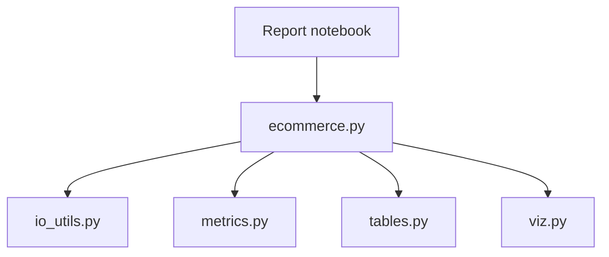

# Group 2 E-commerce analysis report
Group assignment for a course in Python programming. The project aims to build an e-commerce report in a Jupyter Notebook, given sample data from a CSV file.

## Quick start
Requires Python 3 (tested with 3.14.7). From the repository root in Windows PowerShell, run:

```powershell
.\.venv\Scripts\python.exe -m pip install -r requirements.txt
$env:PYTHONPATH = (Get-Location).Path  # Sets the local env, just in case
.\.venv\Scripts\python.exe -m jupyterlab notebook/ecommerce_sales.ipynb
```

Select the Python 3 kernel and choose **Run → Run All Cells**.

On macOS/Linux, replace `.\.venv\Scripts\python.exe` with `.venv/bin/python` (unverified).

## Goals
As per the assignment, the analysis part of this assignment aims to answer:
1. What sells? (Which categories generate the most income?)
2. Where do we sell? (Which cities account for the largest share of revenue?)
3. When do we sell? (Are there any clear time patterns for the given period?)
4. What does a typical order look like? (Average order value and spread.)
5. Top lists (Top 3 categories based on revenue.)
6. Deviations (Other patterns that stand out.) 

## Workflow
Our agreed-upon workflow is as follows:

1. Read the issue specification.
2. Create a local branch from an updated main. In order, run the following:
    - `git switch main`
    - `git pull --ff-only`
    - `git switch -c [name]/[description-of-work]`
3. Solve the issue.
4. Test the solution (the program must run).
5. Make a commit with a descriptive message:
    - `git commit -m "[description]"`
6. Push your code to remote (`git push`).
7. Open a pull request and link the issue by adding "References #[issue number]" or "Solves #[issue number]" to the PR description.
    - Writing 'Solves' or 'Closes' will automatically close the related issue when the PR is merged.
    - Writing 'References' will simply link the issue.
8. Briefly describe your changes in the pull request description.
9. Let the group examine and approve your changes.
    - Fix or address any feedback.
10. Merge the pull request when it is approved.

## Responsibilities
Responsibilities are divided by file, but subject to change as work progresses.
- Charlie - io_utils.py
- Katerina - metrics.py
- Natasa - viz.py
- Jacob - ecommerce_sales.ipynb, README.md (documentation), and final check

## Architecture
`CommerceAnalyzer` in `src/ecommerce.py` loads data and coordinates calculations and presentation.



- `io_utils.py` loads the dataset.
- `metrics.py` prepares calculation results.
- `tables.py` formats prepared results as `Styler` tables.
- `viz.py` renders prepared results as `Figure` objects.

Notebook code cells contains analyzer setup and output calls, and markdown cells contain the analysis.

## Project structure
The project structure follows the proposed template given in the assignment description. 
```
grupp-2-ehandel/
├── data/
│   └── ecommerce_sales.csv    # Input dataset for the analysis
├── notebook/
│   └── ecommerce_sales.ipynb  # Main analysis notebook
├── src/
│   ├── ecommerce.py           # E-commerce analysis, notebook interface
│   ├── io_utils.py            # Data loading, file handling
│   ├── metrics.py             # Sales metric calculations
│   ├── tables.py              # Styling the tables
│   └── viz.py                 # Charts, visualizations
├── .gitignore
└── README.md
```
